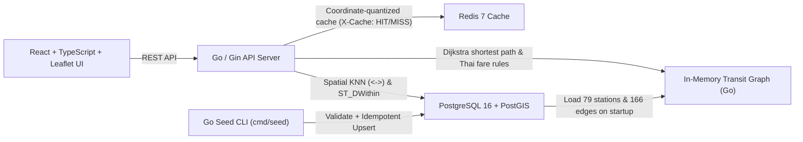

# Bangkok Commute Map

> ค้นหาและเปรียบเทียบทำเลคอนโด/อพาร์ตเมนต์ในกรุงเทพฯ ตาม **“เวลาเดินทางจริงด้วย BTS/MRT/ARL”** และ **“ค่าครองชีพรวมจริงต่อเดือน (ค่าเช่า + ค่าเดินทาง)”**


**Live Demo:** https://bangkok-commute-map.vercel.app/ · **25s Demo Video:** [`docs/bangkok-commute-map-demo.mp4`](docs/bangkok-commute-map-demo.mp4) · **Case Study:** [`docs/PORTFOLIO_CASE_STUDY.md`](docs/PORTFOLIO_CASE_STUDY.md)

---

## Why This Project?

การค้นหาที่พักในกรุงเทพฯ แบบรัศมีวงกลม (Straight-line radius) ไม่ตรงกับความจริง เพราะเวลาและค่าใช้จ่ายขึ้นอยู่กับ **โครงข่ายรถไฟฟ้า (BTS / MRT / ARL)**, **จุดเปลี่ยนสาย**, **กฎค่าโดยสารแยกค่าย + ส่วนต่อขยาย** และ **ระยะเดิน vs วินมอเตอร์ไซค์**

**Bangkok Commute Map** แก้ปัญหานี้ด้วยการผสาน **PostGIS Spatial Indexing** เข้ากับ **In-Memory Transit Graph (Dijkstra ใน Go)** และ **Redis Caching** เพื่อแสดงโซนเวลาเดินทางจริงและเปรียบเทียบ **True Monthly Cost** ของ 2–3 ทำเลข้างกันได้ทันที

---

## System Architecture



---

## Core Engineering Highlights

### 1. PostGIS Spatial Queries (`GEOGRAPHY(Point, 4326)` + `GIST`)
- **KNN Index-Assisted Nearest Stations** (`ORDER BY location <-> ST_SetSRID(ST_MakePoint($1, $2), 4326)::geography LIMIT 3`) สำหรับหาสถานีรถไฟฟ้าใกล้ออฟฟิศ 3 แห่งแรก
- **Geographic Radius Filtering** (`ST_DWithin(l.location, s.location, $1)`) หารายการที่พักรอบกลุ่มสถานีที่เดินทางถึงทันเวลาเป็นเมตรจริงบนพื้นโลก

### 2. Transit Graph & Thai Fare Engine (`backend/internal/transit`)
- **79 สถานี / 166 directed edges** ครอบคลุม BTS สุขุมวิท & สีลม (ระบุส่วนต่อขยาย), MRT น้ำเงิน & ม่วง และ ARL พร้อมจุดเปลี่ยนสายหลักทั้งหมด
- **Transfer Penalty**: เปลี่ยนสายในระบบเดียวกัน (สยาม / เตาปูน) `+3 นาที` ตั๋วใบเดียว • เปลี่ยนข้ามระบบ (อโศก↔สุขุมวิท, ศาลาแดง↔สีลม, พญาไท, เพชรบุรี↔มักกะสัน ฯลฯ) `+6–7 นาที` และคิดค่าโดยสารแยกใบตามจริง
- **BTS Extension Rules**: ส่วนต่อขยาย `+15 บาท` (สูงสุด `62 บาท`) และนั่งเฉพาะส่วนต่อขยาย `15 บาท`
- **Access / Feeder Mode**: เดิน `80 ม./นาที` ภายในระยะที่ตั้งไว้ และสลับเป็นวินมอเตอร์ไซค์ (`300 ม./นาที` + `15–25 บาท/เที่ยว`) อัตโนมัติเมื่อเกินระยะ

### 3. True Monthly Cost Formula
$$\text{TrueMonthlyCost} = \text{MonthlyRent} + (\text{OneWayFare} + \text{OneWayFeeder}) \times 2 \times \text{Workdays}$$
$$\text{MonthlyCommuteHours} = \frac{\text{OneWayMinutes} \times 2 \times \text{Workdays}}{60}$$

### 4. Redis Caching + Observability
- **Coordinate Quantization**: ปัดพิกัดหมุดออฟฟิศเป็นทศนิยม 3 ตำแหน่ง (~100 ม.) เพื่อให้จุดใกล้กันแชร์แคชได้ (TTL 15 นาที)
- **Visible Proof**: แนบ HTTP headers `X-Cache: HIT|MISS` และ `X-Query-Time-Ms` แสดงผลสดใน UI
- **Graceful Degradation**: หาก Redis ไม่พร้อมใช้งาน API ยังทำงานต่อผ่าน PostGIS ได้โดยไม่ล่ม

---

## API Endpoints

| Method | Endpoint | Description |
| :--- | :--- | :--- |
| `GET` | `/api/health` | เช็กสถานะ API, PostGIS version และ Redis |
| `GET` | `/api/presets` | รายชื่อออฟฟิศยอดฮิต 6 ย่าน (อโศก, สยาม, สีลม, พระราม 9, อารีย์, วัน แบงค็อก) |
| `GET` | `/api/commute/search` | ค้นหาสถานีที่ถึงทันเวลาพร้อมสีโซน และที่พักเรียงตาม `true_monthly_cost_thb` (`X-Cache` + `X-Query-Time-Ms`) |
| `POST` | `/api/commute/compare` | เปรียบเทียบ 2–3 ที่พักข้างกัน พร้อมสรุปส่วนต่างค่าใช้จ่ายและชั่วโมงเดินทางต่อเดือน |

---

## Local Development

### Prerequisites
- Docker Desktop (PostGIS 16 + Redis 7)
- Go 1.24+
- Node.js 22+

### Run Locally
```bash
# 1. Start PostGIS + Redis
docker compose up -d

# 2. Run SQL migrations & idempotent data seed (79 stations, 166 edges, 30 fare rules, 183 listings)
make seed

# 3. Start Go/Gin API server (port 8081 matches Vite dev proxy default)
API_PORT=8081 make api

# 4. In another terminal, start React + Leaflet frontend
cd frontend && npm install && npm run dev
```
Open **http://localhost:5173**

### Run Full Stack in Docker
```bash
docker compose --profile full up -d --build
```
Open **http://localhost:3000**

---

## Testing & CI

```bash
# Run all Go unit + HTTP + PostGIS/Redis integration tests
cd backend && REQUIRE_DB_TESTS=1 go test -v -race -count=1 ./...

# Verify frontend TypeScript & Vite production build
cd frontend && npm run build
```

GitHub Actions ([.github/workflows/ci.yml](.github/workflows/ci.yml)) runs automatically on every push/PR with real `postgis/postgis:16-3.4` and `redis:7-alpine` service containers, verifies seed idempotency twice, executes `go test -race ./...`, and builds the frontend.

---

## Cloud Deployment (Free Tier Ready)

1. **PostgreSQL + PostGIS**: Create a free database on [Neon](https://neon.tech) or [Supabase](https://supabase.com) and copy `DATABASE_URL`.
2. **Redis (Optional)**: Create a free Redis instance on [Upstash](https://upstash.com) and copy `REDIS_URL` (`rediss://...`).
3. **Backend API (Render)**: Connect this repo on [Render](https://render.com) using `render.yaml` (`SEED_ON_START=true` seeds PostGIS automatically on boot).
4. **Frontend (Vercel)**: Import `frontend/` as root directory on [Vercel](https://vercel.com) and set `VITE_API_BASE_URL=https://<your-render-service>.onrender.com`. Set `CORS_ALLOW_ORIGIN` on Render to your Vercel URL.
